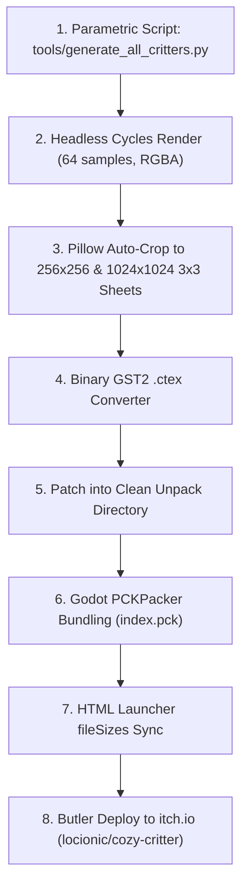

# Blender 3D Critter Roster Migration Plan

> **Goal**: Expand the successful 3D Blender "fluffball" (Mochi Cat) pipeline to all 7 remaining game critters, replacing legacy 2D sticker illustrations with tactile, unpadded 3D clay/vinyl figurines.

---

## 1. Executive Summary & Lessons Learned from "Fluffball"

The first migration (**Mochi Cat**) resolved all character padding and visual quality defects:
* **Tactile 3D Form**: Subdivision Surface (`Subsurf` lvl 2) over UV sphere primitives produced a smooth, squishy clay/vinyl toy aesthetic.
* **Warm 4-Point Studio Rig**: Warm golden key sun (`#FFF5E0`), cool ambient fill (`#E0EDFF`), rim highlight (`#FFE6BF`), and an under-chin bounce light (`#FFF2E0`) that eliminated neck grain.
* **Mathematical 0-Padding**: Unified bounding box detection across all animation frames locked feet to the exact bottom baseline, eliminating detached shadows.
* **Native Godot Binary Synthesis**: Direct synthesis of Godot 4 `GST2` `.ctex` binaries and packing via `PCKPacker` enabled instant deployment to itch.io (`v1.0.2-blender-3d-critter`).

The remaining 7 critters currently still use legacy 2D watercolor cutouts with white sticker outlines, uneven margins, and flat labels. This plan details their full migration.

---

## 2. Critter Anatomy & Material Specifications

```
Critter Roster Overview:
├── mochi_cat       [COMPLETED] Cream white, perky kitten ears, blush, curled tail
├── shiba_pup       [PLANNED]   Sesame toast, cream muzzle mask, triangular ears, doughnut tail
├── lop_bunny       [PLANNED]   Lavender-cream, downward floppy ears, cotton-ball tail
├── chubby_hamster  [PLANNED]   Sunflower caramel, 1.4x puffed cheek pouches, acorn ears
├── bouncy_critter  [PLANNED]   Mint pistachio, squishy slime form, teardrop bounce antenna
├── sparkle_critter [PLANNED]   Buttercup yellow, fluffy neck ruff, forehead gem
├── starry_dragon   [PLANNED]   Twilight plum, golden belly plates, tiny chibi wings
└── dreamer_critter [PLANNED]   Cloud blue, golden star crest, sleepy crescent eyes
```

### Spec 1: Shiba Pup (`shiba_pup`)
* **Palette**: Fur `#D68A48` (sesame toast), Muzzle/Belly `#FFF6EB` (cream), Inner Ears `#F4A69D` (soft pink).
* **Anatomy**:
  * Body: Squishy pear base `(1.04, 0.94, 0.84)`.
  * Head: Round chibi head `(1.12, 0.98, 0.94)` with extruded white muzzle snout.
  * Ears: Perky triangular cones tilted forward `12°`.
  * Tail: Torus / curved cylinder curled in a doughnut loop over the back.
* **CTEX Targets**:
  * `shiba_pup.png` (Portrait: 256x256)
  * `shiba_pup_sheet.png` (3x3 grid: 1024x1024)
  * `shiba_pup/` (`idle_0`, `idle_1`, `idle_2`, `hop_crouch`, `hop_air`, `hop_land`, `eat`, `joy`, `sleep`)

### Spec 2: Lop Bunny (`lop_bunny`)
* **Palette**: Fur `#F3EEF5` (soft lavender-cream), Inner Ears `#F7C5D2` (rosy pink), Nose `#E88B88`.
* **Anatomy**:
  * Body: Rounded dome base `(1.08, 0.96, 0.80)`.
  * Head: Wide chubby cheeks with button nose.
  * Ears: Elongated tapered capsules rotated downwards `85°`, resting gently alongside the cheeks.
  * Tail: Fluffy round cotton-ball sphere at rear `z = 0.22`.
* **CTEX Targets**:
  * `lop_bunny.png` (Portrait: 256x256)
  * `lop_bunny/` individual animation frames

### Spec 3: Chubby Hamster (`chubby_hamster`)
* **Palette**: Coat `#E6B87D` (sunflower caramel), Belly/Cheeks `#FFFDF9` (pure cream).
* **Anatomy**:
  * Body: Low stout sphere `(1.15, 1.05, 0.78)`.
  * Cheeks: Dual exaggerated cheek pouch spheres scaled `1.4x` outward.
  * Ears: Small rounded half-disks angled slightly outward.
  * Paws: Tiny stubby front paws clutching a sculpted sunflower seed / acorn.
* **CTEX Targets**:
  * `chubby_hamster.png` (Portrait: 256x256)

### Spec 4: Bouncy Critter (`bouncy_critter`)
* **Palette**: Jelly `#A8E6CF` (pastel mint-pistachio), Cheek blush `#FFD3B6`.
* **Anatomy**:
  * Body: Soft droplet teardrop sphere with high elasticity and extreme squash-stretch range.
  * Antenna: Gentle spiraled teardrop antenna on crown with glowing tip.
  * Paws: Tiny grounded puddles that squash completely during `hop_crouch`.
* **CTEX Targets**:
  * `bouncy_critter.png` (Portrait: 234x256 -> normalized to 256x256)
  * `bouncy_critter_sheet.png` (1024x1024)
  * `bouncy_critter/` animation frames

### Spec 5: Sparkle Critter (`sparkle_critter`)
* **Palette**: Coat `#FFF3B0` (buttercup yellow), Ruff `#FFEAA7`, Gem `#74B9FF` (glowing sapphire).
* **Anatomy**:
  * Body: Slender pear base with quadruped paws.
  * Chest Ruff: Cluster of 5 overlapping soft spheres forming a fluffy collar.
  * Forehead: Beveled diamond gem with subtle emissive shader component.
* **CTEX Targets**:
  * `sparkle_critter.png` (Portrait: 256x256)
  * `sparkle_critter_sheet.png` (1024x1024)
  * `sparkle_critter/` animation frames

### Spec 6: Starry Dragon (`starry_dragon`)
* **Palette**: Scales `#6C5B7B` (twilight plum), Belly Plates `#F8B195` (peach gold), Horns `#F6C86E`.
* **Anatomy**:
  * Body: Chubby seated dragon with segmented belly ridge lines.
  * Head: Soft rounded snout with small blunt golden horns.
  * Wings: Tiny beveled chibi wings folded at shoulder height.
  * Tail: Tapered curved tail with a spade/star tip.
* **CTEX Targets**:
  * `starry_dragon.png` (Portrait: 256x256)
  * `starry_dragon_sheet.png` (1024x1024)
  * `starry_dragon/` animation frames

### Spec 7: Dreamer Critter (`dreamer_critter`)
* **Palette**: Cloud body `#BEE3F8` (powder sky blue), Star Crest `#FFE66D` (starlight gold).
* **Anatomy**:
  * Body: Puffy cloud-like squishy torso.
  * Eyes: Crescent-shaped sleepy eyelids with soft lash tips.
  * Horn/Crest: Stylized five-point star crest centered above the forehead.
* **CTEX Targets**:
  * `dreamer_critter.png` (Portrait: 256x207 -> normalized to 256x256)

---

## 3. Standardized Animation Frame Set (9 Poses per Critter)

Every critter will produce the standard 9-frame animation matrix:

| Frame Name | Transform Keyframes | Expression / Facial State |
| :--- | :--- | :--- |
| `idle_0` | Default baseline geometry | Eyes wide open, double specular shine |
| `idle_1` | `body_s: (1.06, 0.96, 0.78)`, `head_z: -0.03` | Breathing in (gentle belly squash) |
| `idle_2` | `body_s: (0.98, 0.88, 0.86)`, `head_z: +0.02` | Breathing out (gentle chest stretch) |
| `hop_crouch`| `body_s: (1.18, 1.06, 0.64)`, `head_z: -0.16` | Deep spring compression before jump |
| `hop_air` | `body_s: (0.88, 0.82, 1.05)`, `head_z: +0.23`, shadow scaled `0.70x` | Peak jump apex, limbs tucked |
| `hop_land` | `body_s: (1.14, 1.02, 0.72)`, `head_z: -0.10` | Ground contact squash rebound |
| `eat` | `body_s: (1.08, 0.96, 0.80)`, cheeks widened `+15%` | Chewing puffed cheeks |
| `joy` | `body_s: (0.94, 0.85, 0.94)`, `head_z: +0.10` | Happy hop, eyes closed into `^ ^` arcs |
| `sleep` | `body_s: (1.12, 1.04, 0.68)`, `head_z: -0.14` | Curled dome, eyes closed into `~ ~` arcs |

---

## 4. Execution Workflow



1. **Automation Script**: Create `tools/generate_all_critters.py` that loops through the 7 critter configurations, generates each 3D mesh in Blender, and renders all 9 frames.
2. **Post-Processing**: Apply Pillow bilateral smoothing, assemble 1024x1024 3x3 sprite sheets, and save high-res `.glb` and `.blend` files in `assets/3d/`.
3. **Binary Packaging**: Convert all PNGs into `GST2` `.ctex` files and repack `index.pck` using `tools/repack_pck.gd`.
4. **Deploy**: Update `fileSizes` in `index.html` and push to itch.io channels `html5` and `web`.

---

## 5. Quality Verification Gate

Before final release, each critter must pass:
* [ ] **Ground Baseline Check**: Lowest paw vertex exactly touches baseline `y = 236` on 256x256 canvas.
* [ ] **Alpha Border Check**: Zero white sticker stroke; 100% clean alpha background.
* [ ] **Shadow Integrity**: Contact shadow disk present and scales organically with squash/stretch.
* [ ] **Godot Test Suite**: `./run_tests.sh` passes 5/5 assertions with exit code 0.
